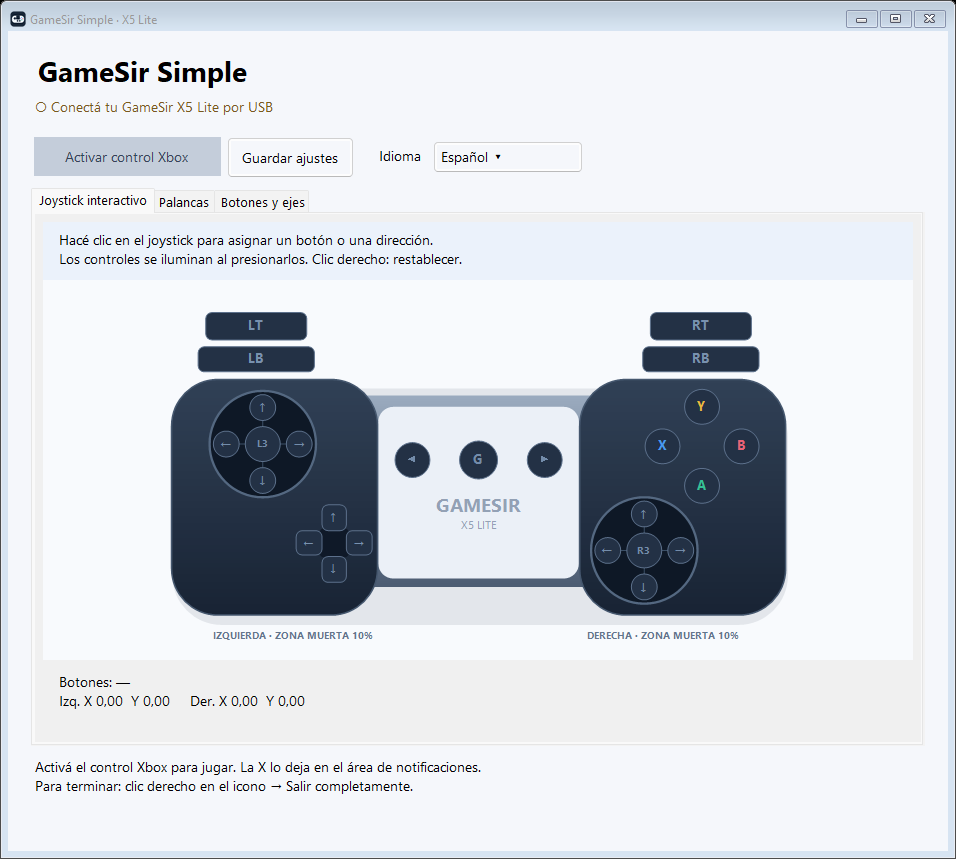
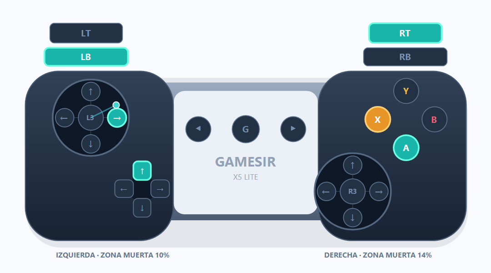

# GameSir Simple

[English](README.md) · [Español](README.es.md) · [简体中文](README.zh-CN.md)

Una app independiente para Windows que convierte tu **GameSir X5 Lite** en un mando virtual de Xbox 360, con lectura propia de entradas, un dibujo interactivo y asignación de controles. **La interfaz permite elegir español, inglés y chino simplificado** desde el selector de idioma. El cambio es inmediato y se guarda para el próximo inicio.

[Descargar la última versión](https://github.com/lferraro1103/gamesir-simple/releases/latest) · [Reportar un problema](https://github.com/lferraro1103/gamesir-simple/issues)



## Funciones

- Mapa específico del X5 Lite y detección automática por USB.
- Clic sobre un botón o dirección para reasignarlo; los controles se iluminan al presionarlos.
- Clic derecho para restablecer una asignación automática.
- Asignación de botones, gatillos, cruceta, direcciones de las palancas y L3/R3.
- Zona muerta radial independiente para cada palanca, recorrido máximo y curva de respuesta.
- Inversión de ejes, calibración del centro y guardado automático.
- Un botón para activar o desactivar Xbox; icono propio en el ejecutable y la ventana.
- Selector inmediato de español, inglés y chino simplificado, incluidas las ayudas y el menú del icono.
- Cerrar a la bandeja, reabrir desde el icono o salir por completo desde su menú.
- Funciona localmente, sin cuentas, telemetría ni solicitudes de red desde la app.

## Requisitos

- Windows 10/11 de **64 bits**.
- GameSir X5 Lite conectado por su conexión USB de datos. Si necesitás un adaptador, debe transmitir datos.
- [ViGEmBus](https://github.com/nefarius/ViGEmBus/releases) instalado. La app no instala drivers automáticamente. ViGEmBus es una dependencia externa cuyo proyecto está archivado.

La versión portátil incluye el runtime de .NET: no hace falta instalar .NET por separado.

## Empezar a jugar

1. Descargá `GameSirSimple-v1.2.1-win-x64.zip` desde [Releases](https://github.com/lferraro1103/gamesir-simple/releases).
2. Extraé el ZIP. El ejecutable integra el mapa del mando y el runtime de .NET; no necesitás un archivo de mapeo separado.
3. Conectá el X5 Lite. No necesitás otro emulador de mandos.
4. Abrí `GameSirSimple.exe` y verificá los controles en **Joystick interactivo**.
5. Tocá **Activar control Xbox** y después abrí el juego. Dejá la app funcionando; podés minimizarla o tocar la X para dejarla en la bandeja.

La **X** deja la app funcionando en el área de notificaciones y mantiene la emulación activa. Hacé doble clic en el icono o elegí **Abrir GameSir Simple** para recuperar la ventana. Para detener la app y retirar el mando virtual, usá clic derecho en el icono → **Salir completamente**. El menú también permite activar o desactivar Xbox. La app no bloquea el apagado de Windows. Si reconectás el GameSir, volvé a activar Xbox.

## Asignar desde el dibujo

1. Hacé clic en el botón Xbox o la flecha que quieras asignar. **L3/R3 son los clics de las palancas**; las flechas representan movimiento.
2. Soltá todos los controles durante un segundo. Cuando diga **Ahora presioná...**, presioná el botón físico o mové la palanca en la dirección indicada.
3. El objetivo aparece en naranja. **Esc** cancela; a los 12 segundos se cancela por tiempo agotado.
4. La asignación detiene la emulación. Al terminar, volvé a tocar **Activar control Xbox**.

Los controles presionados se iluminan en turquesa. Con clic derecho podés restablecer el mapa automático de un control. La tabla **Botones y ejes** permite hacer las mismas asignaciones. Para reasignar una palanca completa, grabá sus cuatro direcciones.



La imagen anterior usa entradas simuladas para mostrar los colores.

## Ajustes de las palancas

| Ajuste | Función |
| --- | --- |
| Zona muerta izquierda / derecha | Zona radial independiente, de 0 a 40%; empieza en 10%. Subila de a poco si hay movimiento al soltar la palanca. |
| Recorrido para llegar al máximo | De 60 a 100%; un valor menor permite alcanzar el máximo antes del borde físico. |
| Curva | 100 es lineal; más de 100 suaviza el centro y menos de 100 aumenta la respuesta cerca del centro. |
| Invertir X / Y | Invierte un eje de una palanca. |
| Calibrar centro | Soltá ambas palancas antes de tocarlo. Se aplica a los ejes automáticos; las asignaciones personalizadas capturan su reposo al grabarlas. |

Los gatillos del X5 Lite son digitales: la app no puede agregarles recorrido analógico físico. Los ajustes se guardan automáticamente en `%LOCALAPPDATA%\GameSirSimple\settings.json`. **Guardar ajustes** también permite guardarlos manualmente.

## Compatibilidad y límites

- Algunos juegos leen el mando físico y el virtual a la vez, y pueden duplicar entradas. Revisá Steam Input o configurá [HidHide](https://github.com/nefarius/HidHide) por separado según el juego. La app no cambia esas opciones.
- Solo selecciona el X5 Lite USB con VID `3537` / PID `1116`. No se cubren otros modelos GameSir.
- No reenvía vibración al mando físico.
- El ejecutable portátil no tiene firma de código.
- Anteriormente se verificaron la detección del hardware y un reporte Xbox virtual mediante XInput de Windows. Esta actualización se verificó sin hardware, incluidas las tres pantallas renderizadas y los 25 eventos de asignación. Falta verificar la compatibilidad juego por juego y completar una prueba manual con hardware.

## Compilar y verificar

Instalá un SDK de .NET 8 y ejecutá desde la raíz del repositorio:

```powershell
dotnet publish src/GameSirSimple/GameSirSimple.csproj -c Release -r win-x64 --self-contained true -p:PublishSingleFile=true -p:IncludeNativeLibrariesForSelfExtract=true -p:DebugType=None -o dist/GameSirSimple
```

El workflow de Windows compila y verifica eventos de clic, mapeo, zonas muertas, validación de ajustes guardados, recursos integrados, limpieza de entradas y las tres pantallas. Estas pruebas no muestran ventanas, no acceden al mando, no crean un Xbox virtual ni modifican tus ajustes guardados:

```powershell
.\dist\GameSirSimple\GameSirSimple.exe --render-preview .\artifacts\visual
```

El diagnóstico opcional de **hardware** requiere el GameSir conectado, sin juegos ni otros emuladores abiertos:

```powershell
.\dist\GameSirSimple\GameSirSimple.exe --diagnostic
```

Crea temporalmente un mando virtual, envía valores fijos de A/LT/palanca, verifica su recepción por XInput y lo desconecta. Guarda `diagnostic.txt` junto al ejecutable. No comprueba todas las pulsaciones físicas.

## Licencia y créditos

Código de la app: [MIT](LICENSE). Los componentes externos conservan sus licencias en [licenses](licenses). Las fuentes y los hashes están en [THIRD_PARTY.md](THIRD_PARTY.md).

Hecho con SDL 2, SDL_GameControllerDB, Nefarius.ViGEm.Client y .NET. Es una app comunitaria no oficial, sin afiliación ni respaldo de GameSir o Microsoft.
