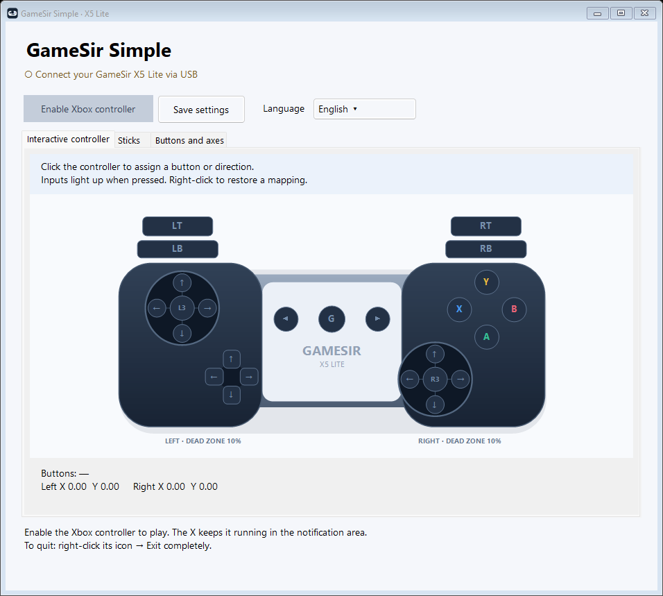
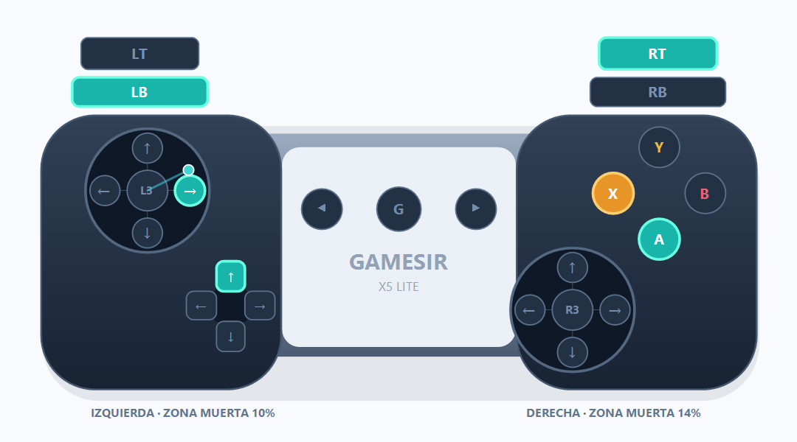

# GameSir Simple

[English](README.md) · [Español](README.es.md) · [简体中文](README.zh-CN.md)

A standalone Windows app that turns a **GameSir X5 Lite** into a virtual Xbox 360 controller, with its own input handling, an interactive controller diagram and simple remapping. **The app interface supports Spanish, English and Simplified Chinese**, switchable instantly from the language selector. Your choice is saved.

[Download the latest release](https://github.com/lferraro1103/gamesir-simple/releases/latest) · [Report a problem](https://github.com/lferraro1103/gamesir-simple/issues)



## Features

- Model-specific X5 Lite button mapping and automatic USB detection.
- Click a button or stick direction in the diagram to remap it; physical input lights up the diagram.
- Right-click a control to restore its automatic mapping.
- Remap buttons, triggers, D-pad directions, stick directions, L3 and R3.
- Independent radial dead zones for both sticks, adjustable maximum travel and response curve.
- Axis inversion, center calibration and automatic saving.
- One button to start or stop Xbox 360 emulation; custom executable/window icon.
- Instant Spanish / English / Simplified Chinese UI selection, including tooltips and tray commands.
- Close to tray, reopen from its icon, or exit completely from the tray menu.
- Local operation without accounts, telemetry or network requests from the app.

## Requirements

- Windows 10/11, **64-bit**.
- GameSir X5 Lite connected over USB through its controller data connection. If an adapter is needed, it must carry data.
- [ViGEmBus](https://github.com/nefarius/ViGEmBus/releases) installed. This app does not install drivers automatically. ViGEmBus is an archived third-party dependency.

The portable release includes the .NET runtime. A separate .NET installation is unnecessary.

## Quick start

1. Download `GameSirSimple-v1.2.1-win-x64.zip` from [Releases](https://github.com/lferraro1103/gamesir-simple/releases).
2. Extract the ZIP. The executable includes its controller mapping and .NET runtime; no separate mapping file is required.
3. Connect your X5 Lite. No other controller emulator is required.
4. Run `GameSirSimple.exe`. Choose **English** in the language selector if desired. Check your inputs under **Interactive controller** (**Joystick interactivo** in Spanish).
5. Click **Enable Xbox controller** (**Activar control Xbox** in Spanish), then launch your game. Keep the app running; minimize it or click X to leave it in the tray.

Clicking **X** hides the window in the notification area and keeps Xbox emulation running. Double-click the tray icon or use **Open GameSir Simple** to restore it. To stop the app and remove its virtual controller, right-click the tray icon and choose **Exit completely**. The tray menu can also enable or disable Xbox. Windows shutdown is not blocked. After reconnecting the physical controller, activate Xbox again.

## Remapping with the diagram

1. Click the target Xbox button or stick-direction arrow. **L3/R3 mean pressing the sticks**, while the surrounding arrows mean stick movement.
2. Release all controls for one second. When **Now press...** appears, press the physical button or move the stick in the requested direction.
3. The target is orange while recording. Press **Esc** to cancel; recording times out after 12 seconds.
4. Recording stops emulation. Click **Enable Xbox controller** when finished.

Pressed controls turn turquoise. Right-click a control and choose its reset action to restore its default mapping. The **Buttons and axes** table offers the same assignments. To remap a complete stick, record all four directions.



The image above uses simulated inputs to illustrate the colors.

## Stick settings

| UI setting | Meaning |
| --- | --- |
| Left / right stick dead zone | Independent radial dead zones, 0–40%; default 10%. Increase gradually if a stick drifts at rest. |
| Travel to reach maximum output | 60–100%; lower values reach full output before the physical edge. |
| Response curve | 100 is linear; above 100 softens response near center, below 100 increases it. |
| Invert X / Y | Reverse an individual stick axis. |
| Calibrate center | Release both sticks before clicking; applies to automatic axes. Custom bindings capture their own resting position while recording. |

X5 Lite triggers are digital; this app cannot create physical analog trigger travel. Settings are saved automatically to `%LOCALAPPDATA%\GameSirSimple\settings.json`. **Save settings** also saves explicitly.

## Compatibility and limits

- If a game reads both the real and virtual devices, duplicate input can occur. Adjust Steam Input or configure [HidHide](https://github.com/nefarius/HidHide) separately as appropriate. The app does not change these settings.
- Only the X5 Lite USB model with VID `3537` / PID `1116` is selected. Other GameSir models are not covered.
- There is no vibration forwarding to the physical controller.
- The portable executable is not code-signed.
- Hardware detection and a virtual Xbox report were previously verified through Windows XInput. This update was checked offline, including all three rendered screens and 25 assignment events. Game-by-game compatibility and a full manual hardware interaction test have not been completed.

## Build and checks

Install a .NET 8 SDK, then run from the repository root:

```powershell
dotnet publish src/GameSirSimple/GameSirSimple.csproj -c Release -r win-x64 --self-contained true -p:PublishSingleFile=true -p:IncludeNativeLibrariesForSelfExtract=true -p:DebugType=None -o dist/GameSirSimple
```

The Windows workflow builds the app and runs offline checks for click events, mapping, dead zones, saved-settings validation, embedded resources, input reset and all three screens. These checks do not display windows, access a controller, create a virtual Xbox or modify saved user settings:

```powershell
.\dist\GameSirSimple\GameSirSimple.exe --render-preview .\artifacts\visual
```

To run the optional **hardware** diagnostic, connect your X5 Lite, close games and other emulators, then run:

```powershell
.\dist\GameSirSimple\GameSirSimple.exe --diagnostic
```

This diagnostic temporarily creates a virtual controller, sends fixed A/LT/stick values and checks their XInput output, then disconnects it. Results are saved to `diagnostic.txt` beside the executable. It does not validate every physical button press.

## License and credits

Application code: [MIT](LICENSE). Third-party components retain their own licenses in [licenses](licenses). See [THIRD_PARTY.md](THIRD_PARTY.md) for provenance and checksums.

Built with SDL 2, SDL_GameControllerDB, Nefarius.ViGEm.Client and .NET. This is an unofficial community app, not affiliated with or endorsed by GameSir or Microsoft.
