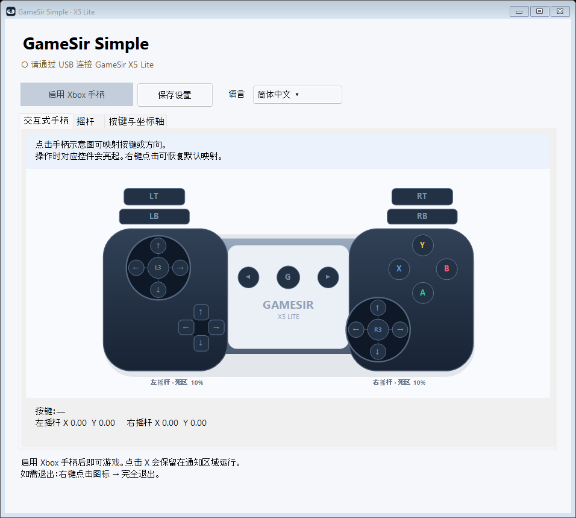
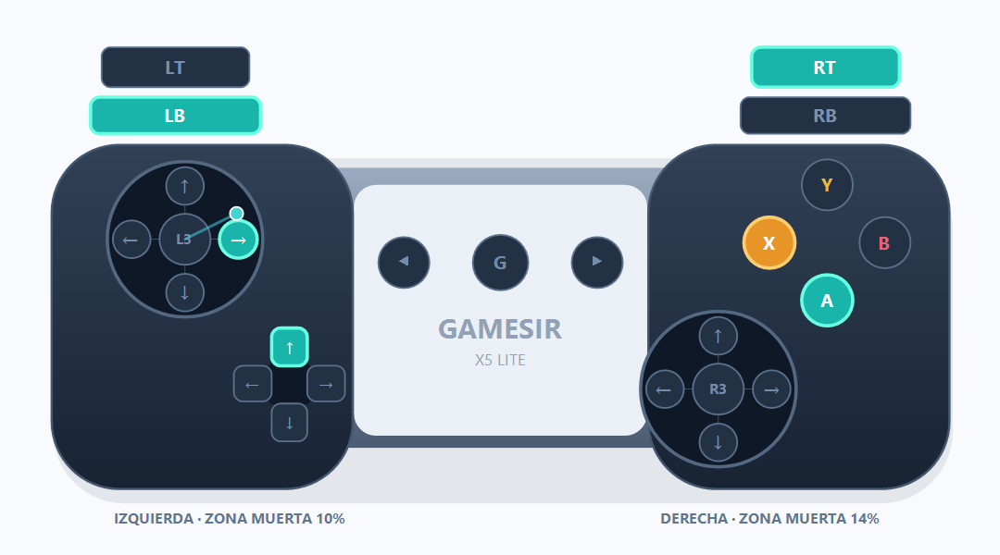

# GameSir Simple

[English](README.md) · [Español](README.es.md) · [简体中文](README.zh-CN.md)

这是一款独立的 Windows 应用，可自行读取 **GameSir X5 Lite** 的输入并映射为虚拟 Xbox 360 手柄，同时提供可点击的手柄示意图。**应用界面支持西班牙语、英语和简体中文**，可通过语言选择器即时切换，并保存所选语言。

[下载最新版本](https://github.com/lferraro1103/gamesir-simple/releases/latest) · [报告问题](https://github.com/lferraro1103/gamesir-simple/issues)



## 功能

- X5 Lite 专用默认映射与 USB 自动检测。
- 点击示意图上的按键或摇杆方向即可重新映射；操作实体手柄时，对应控件会亮起。
- 右键点击控件可恢复其默认映射。
- 支持按键、扳机、方向键、摇杆方向以及 L3/R3 映射。
- 左右摇杆独立径向死区、最大行程和响应曲线调节。
- 坐标轴反转、中心校准与自动保存。
- 一键开启或关闭 Xbox 模拟，并附带应用图标。
- 即时切换西班牙语、英语和简体中文，包括提示及托盘菜单。
- 点击 X 保留在托盘运行，可通过图标重新打开或完全退出。
- 本地运行，无需账号，不收集遥测数据，应用本身不发送网络请求。

## 系统要求

- **64 位** Windows 10/11。
- GameSir X5 Lite 通过手柄的数据接口连接 USB；如需转接器，转接器必须支持数据传输。
- 已安装 [ViGEmBus](https://github.com/nefarius/ViGEmBus/releases)。本应用不会自动安装驱动。ViGEmBus 是已归档的第三方项目。

便携版已包含 .NET 运行时，无需单独安装 .NET。

## 快速开始

1. 在 [Releases](https://github.com/lferraro1103/gamesir-simple/releases) 中下载 `GameSirSimple-v1.2.2-win-x64.zip`。
2. 解压 ZIP。可执行文件已内置手柄映射和 .NET 运行时，无需额外的映射文件。
3. 连接 X5 Lite，无需其他手柄模拟程序。
4. 运行 `GameSirSimple.exe`，可在语言选择器中选择 **简体中文**，然后在**交互式手柄**页面检查输入。
5. 点击**启用 Xbox 手柄**，然后启动游戏。游戏中请保持应用运行；可最小化，也可点击 X 将其保留在托盘。

点击 **X** 会将窗口隐藏到通知区域，Xbox 模拟仍继续运行。双击托盘图标或选择**打开 GameSir Simple** 可恢复窗口。若要停止应用并移除虚拟手柄，请右键点击图标，选择**完全退出**。托盘菜单也可启用或停用 Xbox。应用不会阻止 Windows 关机。重新连接实体手柄后，请再次启用 Xbox。

## 通过示意图重新映射

1. 点击要映射的 Xbox 按键或摇杆方向箭头。**L3/R3 表示按下摇杆**，周围的箭头表示推动摇杆的方向。
2. 松开所有控件，等待一秒。出现 **现在按下或推动...** 提示后，按下实体按键或沿目标方向推动摇杆。
3. 正在映射的目标会显示为橙色。按 **Esc** 可取消；12 秒内未完成也会取消。
4. 映射时会停止模拟。完成后请再次点击 **启用 Xbox 手柄**。

按下的控件会显示为青绿色。右键点击控件并选择恢复选项，可以还原该控件的默认映射。**按键与坐标轴**表格提供相同的映射功能。重新映射整个摇杆时，需要分别录入四个方向。



上图使用模拟输入展示颜色，并非实际游戏画面。

## 摇杆设置

| 界面文字 | 含义 |
| --- | --- |
| 左 / 右摇杆死区 | 左右摇杆独立径向死区，范围 0–40%，默认 10%。若摇杆松开后仍有漂移，可逐步增大。 |
| 达到最大输出所需行程 | 最大输出所需行程，范围 60–100%。降低此值可在到达实体边缘前达到最大输出。 |
| 响应曲线 | 100 为线性；高于 100 时中心附近响应更柔和，低于 100 时中心附近响应更灵敏。 |
| 反转 X / Y 轴 | 反转指定摇杆的 X 或 Y 轴。 |
| 校准中心 | 点击前请松开两个摇杆。此校准用于自动映射的坐标轴；自定义映射会在录入时保存静止位置。 |

X5 Lite 的扳机为数字式，应用无法使其获得实体模拟行程。设置会自动保存至 `%LOCALAPPDATA%\GameSirSimple\settings.json`，也可点击 **保存设置**手动保存。

## 兼容性与限制

- 某些游戏会同时读取实体手柄与虚拟手柄，从而产生重复输入。可根据游戏单独调整 Steam Input，或配置 [HidHide](https://github.com/nefarius/HidHide)。本应用不会修改这些设置。
- 仅选择 USB VID `3537` / PID `1116` 的 X5 Lite，不涵盖其他 GameSir 型号。
- 不向实体手柄转发振动。
- 便携版可执行文件未进行代码签名。
- 之前已验证实体设备检测与 Windows XInput 接收虚拟 Xbox 输入报告。本次更新通过离线检查验证，包括三个页面的渲染与 25 个映射事件。尚未逐款验证游戏兼容性，也未完成使用硬件的完整手动交互测试。

## 编译与检查

安装 .NET 8 SDK，在仓库根目录执行：

```powershell
dotnet publish src/GameSirSimple/GameSirSimple.csproj -c Release -r win-x64 --self-contained true -p:PublishSingleFile=true -p:IncludeNativeLibrariesForSelfExtract=true -p:DebugType=None -o dist/GameSirSimple
```

Windows 工作流会编译应用，并离线验证点击事件、映射、死区、已保存设置的数据校验、内置资源、输入清除以及三个页面。以下检查不会显示窗口、访问手柄、创建虚拟 Xbox 手柄或修改用户保存的设置：

```powershell
.\dist\GameSirSimple\GameSirSimple.exe --render-preview .\artifacts\visual
```

如需运行可选的**硬件诊断**，请连接 X5 Lite，并关闭游戏及其他模拟程序后执行：

```powershell
.\dist\GameSirSimple\GameSirSimple.exe --diagnostic
```

该诊断会临时创建虚拟手柄，发送固定的 A、LT 和摇杆数值，通过 XInput 验证后断开虚拟手柄。结果保存在可执行文件旁的 `diagnostic.txt` 中。它不会验证每一个实体按键操作。

## 许可证与致谢

应用代码使用 [MIT 许可证](LICENSE)。第三方组件保留各自的许可证，详见 [licenses](licenses)。来源与校验值见 [THIRD_PARTY.md](THIRD_PARTY.md)。

基于 SDL 2、SDL_GameControllerDB、Nefarius.ViGEm.Client 和 .NET 构建。本项目是非官方社区应用，与 GameSir 或 Microsoft 无关联，亦未获其认可。
